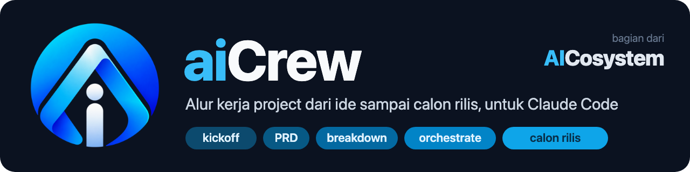
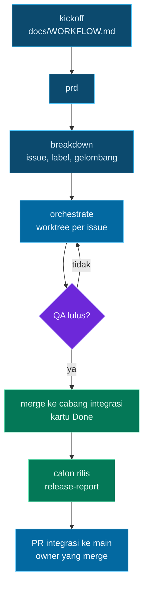

# aiCrew

<p align="center"></p>

<p align="center">
  <a href="LICENSE"></a>
  <a href="https://github.com/goeroeku/aicrew/actions/workflows/tests.yml"></a>
  
  
  
</p>

> [!NOTE]
> **aiCrew** adalah bagian dari **AICosystem**.

Plugin Claude Code untuk alur kerja project dari ide sampai calon rilis: **kickoff → PRD → breakdown ke issue → eksekusi paralel oleh role**
(principal, senior-coder, qa, security, perf, devops, ui-ux), masing-masing dengan model yang sesuai bobot tugasnya. Dokumen dan skill berbahasa Indonesia.

Prinsip: **setiap gerbang bawaannya manual (owner memutuskan)**, dengan opsi yang bisa diset ke otomatis di `docs/WORKFLOW.md` project Anda.

## 🧭 Alur



Contoh keluaran nyata (dipotong) dari project uji `aicrew-uji`. Log autopilot untuk satu issue yang selesai sendiri:
```
2026-10-28 11:50:55 putaran 1: 1 issue terbuka (0 needs-principal)
2026-10-28 11:53:22 autopilot: semua issue selesai (putaran 1)
```
Laporan calon rilis (`release-report.sh`):
```
# Laporan calon rilis: uji-integrasi -> main
**Vonis fakta: SIAP**
## Suite penuh (salinan segar uji-integrasi)
`node --test` -> exit 0: ℹ tests 14 ℹ pass 14 ℹ fail 0
## PR ter-merge ke uji-integrasi
- #17 Tes regresi: pesan kesalahan CLI untuk operasi tak dikenal
- #15 README: bagian Batasan
```

## 📦 Prasyarat
- Claude Code, `git`, `jq`, dan `gh` (sudah login; backend GitHub). GitLab (`glab`) hanya sebagian didukung.
- Opsional: `codex` (senior-coder mengerjakan kode lewat Codex; tanpanya dipakai subagen Claude), scope `gh` `project` (kanban), `caffeinate` (macOS, menahan Mac tetap bangun saat autopilot).

## 🚀 Pasang dan coba
Tanpa clone atau fork (Claude Code mengunduh repo ini sendiri sebagai marketplace):
```
claude plugin marketplace add goeroeku/aicrew
claude plugin install aicrew@aicrew
```
Di dalam sesi Claude Code bentuknya `/plugin marketplace add goeroeku/aicrew` lalu `/plugin install aicrew@aicrew`. Bila SSH ke GitHub belum diatur,
pakai URL penuh: `claude plugin marketplace add https://github.com/goeroeku/aicrew.git`. Terpasang: 4 skill, 7 agen, 1 hook; beban tetap sekitar 380 token per sesi.
Mencoba dari salinan lokal tanpa memasang: `claude --plugin-dir /path/ke/aicrew`.

**Unduh tanpa marketplace:** setiap rilis (tag `vX.Y.Z`) di halaman Releases berisi `aicrew-X.Y.Z.zip`, `.tar.gz`, dan `SHA256SUMS`. Verifikasi lalu pakai:
```
shasum -a 256 -c SHA256SUMS
unzip aicrew-X.Y.Z.zip
claude --plugin-dir ./aicrew-X.Y.Z
```

Lalu di project Anda: `/aicrew:kickoff` (tulis `docs/WORKFLOW.md`), `/aicrew:prd`, `/aicrew:breakdown`, `/aicrew:orchestrate`.

## 🎛️ Opsi otomatis (semuanya bawaan manual)
| Gerbang | Bawaan | Opsi |
|---|---|---|
| Merge PR ke cabang integrasi | owner | `agen-setelah-QA` (suite hijau + QA lulus + tanpa `needs-principal`) |
| Kartu Done di board | owner | `agen-setelah-merge` |
| `needs-principal` tingkat 1 (keputusan desain dalam batas PRD) | owner | `principal-auto` (dicatat sebagai `keputusan-otomatis`) |
| `needs-principal` tingkat 2 (bertentangan PRD, auth/uang/data pribadi, sulit dibalik) | owner | tidak ada opsi otomatis |
| Merge ke `main` | owner | belum ada opsi otomatis |

## 🤖 Autopilot (berhari-hari, tahan limit)
`bash scripts/autopilot.sh [--sleep 1800] [--max-total N]` dari akar repo project: menjalankan `claude -p` dengan skill orchestrate secara berulang
(sesi baru tiap putaran; state ada di GitHub dan `.aicrew/`), tidur lalu mencoba lagi saat kena limit, dan berhenti saat selesai (exit 0),
error beruntun (1), buntu (2), hanya menunggu owner (3), atau batas total (4). Log: `.aicrew/autopilot.log`.

**Menunggu owner.** Bila satu putaran tidak mengubah apa pun dan semua issue tersisa hanya menunggu manusia (`needs-principal`, atau PR terbuka menunggu merge),
autopilot tidak lagi menjalankan `claude`: ia memantau lewat `gh` tiap `--wait` detik (bawaan 600) tanpa memakai token. Begitu ada perubahan (mis. Anda merge PR),
putaran berikutnya jalan dan Resume menyelesaikan sisanya; Anda tidak perlu mengabari lewat chat. Batas tunggu `--wait-max` (bawaan 7 hari), lalu berhenti dengan exit 3
dan satu notifikasi. Sidik jari akhir putaran disimpan di `.aicrew/`, jadi setelah laptop mati lalu hidup lagi, autopilot langsung menunggu tanpa membakar putaran.

### Lanjut otomatis setelah laptop mati/tidur (macOS)
`bash scripts/autostart.sh install <repo> --max-total N` memasang LaunchAgent per project (login dan tiap 15 menit) yang menjalankan `autopilot.sh` bila belum berjalan.
`--max-total` wajib (batas biaya); izin dari `install-permissions.sh` harus sudah terpasang. Pengaman: `.aicrew/PAUSE` melewati tick; `.aicrew/halted` (autopilot berhenti
dengan exit selain 0/3/4) menghentikan tick berikutnya sampai `autostart.sh resume <repo>`; kunci PID mencegah autopilot ganda; tanpa `gh`/jaringan tick dilewati.
Token Telegram dibaca dari `~/.config/aicrew/env` (`export AICREW_TG_TOKEN=... AICREW_TG_CHAT=...`, izin 600), bukan dari plist. Lihat `autostart.sh status|uninstall <repo>`.

> [!IMPORTANT]
> Sesi `-p` tidak bisa meminta persetujuan, jadi izin tool harus dipasang lebih dulu. Daftar minimal: `templates/autopilot-permissions.json`;
> pasang ke `.claude/settings.local.json` project dengan `bash scripts/install-permissions.sh` (menggabungkan, tidak menimpa; mengisi path milik Anda).
> Jangan memakai `--dangerously-skip-permissions`. Argumen tambahan lewat `AICREW_CLAUDE_ARGS` (mis. `--max-budget-usd 3`).
> Pola pesan limit adalah dugaan yang belum diuji dengan limit sungguhan; bila meleset, putaran dihitung sebagai error dan autopilot berhenti dengan aman setelah 3 kali.

## 📋 Calon rilis
`bash scripts/release-report.sh --test-cmd "<perintah tes penuh>" --dry-run` menulis `.aicrew/release-report.md`: vonis fakta SIAP/BELUM SIAP
(suite di salinan segar, PR tanpa bukti, issue belum di-integrasi, `needs-principal`). `--buka-pr` (tanpa `--dry-run`) membuka PR integrasi → main bila SIAP. Tidak pernah merge.

## 🧭 Journey dan epic (untuk lead)
Lead biasanya bertanya per journey ("kapan pengguna bisa masuk dengan SSO?"), bukan per task. Hierarkinya:
```
Journey / epic   J1: pengguna dapat masuk dengan SSO       <- dibaca lead (issue berlabel epic, "4/7 selesai")
  └ FR / NFR     R3, R4, N1 (bagian Kebutuhan di PRD)      <- kriteria yang bisa dicek
       └ Issue   #12, #13, #14                             <- task kecil yang dikerjakan agen
```
PRD memuat bagian *Journeys* dan *Kebutuhan non-fungsional*; breakdown membuat satu epic per journey (`templates/EPIC.md`) dengan daftar centang issue anak.
Pada proyek yang sudah berjalan, membuat epic tidak mengedit issue lama (hanya dirujuk); yang tidak cocok masuk epic `[J0] Unassigned`.
**Di kanban:** epic ikut di board dengan status yang dihitung dari anaknya oleh `board.sh <owner> <nomor> --sync`: Backlog (belum ada anak berjalan), In progress (ada anak berjalan), In review (semua anak selesai, siap ditutup owner), Done (ditutup owner). Satu langkah manual sekali di UI: buat view tersimpan bernama "Journeys" dengan filter `label:epic` (API belum bisa membuat view berfilter), supaya lead melihat satu baris per journey.
Epic bukan pekerjaan: agen dan skrip melewatinya. Progres epic mengikuti penutupan issue anak, yaitu saat merge ke `main`.

**Sub-issue native dan progres epic (0.6.0).** `scripts/epic-link.sh <epic> <anak...>` memasang anak ke epic lewat daftar centang dan sub-issue native GitHub (id numerik, idempoten); `epic-link.sh --inherit <sumber> <anak>` membuat issue lanjutan mewarisi epic sumbernya. `board.sh --sync` membaca anak dari sub-issue native (cadangan: daftar centang), menulis progres ("6/9 Done, 1 In progress") ke satu komentar epic, menandai epic **In progress** begitu sebagian anak Done, dan baru **In review** bila semua anak selesai, ada minimal satu anak bukan-discovery (label `discovery`/`phase:discovery`), dan epic tak berlabel `belum-dipecah`. `Tutup issue setelah merge integrasi: ya` di WORKFLOW.md membuat `--sync` menutup issue `di-integrasi` agar progres sub-issue ikut bergerak. WORKFLOW.md dibaca dari cabang integrasi bila ada (`scripts/workflow.sh`), bukan hanya checkout aktif.

**Konsep (0.6.1).** Journey = epic = induk; issue kerja = sub-issue native dari epic. Status "closed" pada issue kerja, dengan opsi `Tutup issue setelah merge integrasi: ya`, berarti *sudah di cabang integrasi, belum dirilis*. Pembeda rilis adalah PR integrasi → `main` dan label `di-integrasi`, bukan status closed. `epic-link.sh --check` mendaftar issue terbuka non-epic yang tidak punya induk (exit 3 bila ada) untuk audit yatim oleh orkestrator atau owner.

**Mode cadangan REST (0.6.4).** Batas GraphQL GitHub (5.000 poin/jam) dipakai bersama semua alat di satu akun. Bila `board.sh` atau `epic-link.sh` terkena batas itu, keduanya mengulang sekali lewat REST (issue, sub-issue, komentar, dan kartu Project v2) dan mengumumkan `mode cadangan REST` di stderr; tanpa loop ulang. Langkah yang butuh data khusus GraphQL dilewati, bukan ditebak: `board.sh --sync` tetap keluar 0 dan mencetak `PERINGATAN: N langkah dilewati (batas GraphQL), jalankan --sync lagi setelah reset`. Kartu memerlukan scope `project`; bila REST menjawab 403/404, operasi kartu dilewati dengan peringatan yang sama dan operasi issue tetap jalan. `pr-merge-check.sh` sengaja tetap menolak saat tidak bisa membaca PR (issue yang ditutup lewat sidebar hanya ada di GraphQL); bedanya, penolakan kini menyebut batas GraphQL dan jam reset (UTC), jadi cukup tunggu lalu ulangi. Jam reset dibaca dari header respons GraphQL, bukan dari `gh api rate_limit` yang bisa menyesatkan.

**Pemeriksaan CVE dependensi (0.7.0).** `scripts/cve-check.sh <lockfile> [--base <basis>]` memeriksa `package-lock.json` (npm), `go.mod` (Go), dan `requirements*.txt` (PyPI, hanya `nama==versi`) ke OSV: kolom paket, versi, ID, CVE, severity, lingkup (`prod|dev`), target, saran (`patch|minor|major|tanpa-perbaikan`), dan paparan (`baru|lama`). Target = versi terendah yang menutup semua kerentanan paket itu; severity kosong pada rekaman Go/PyPI dipinjam dari kembaran GHSA, dan yang tetap tanpa peringkat (`UNKNOWN`) diperlakukan seperti HIGH. **Gerbang PR:** bila diff menyentuh manifest/lockfile, `pr-merge-check.sh` memeriksa hanya paket yang baru atau berubah dibanding cabang tujuan, dan memblokir paparan baru bersifat HIGH/CRITICAL/UNKNOWN pada dependensi `prod` kecuali ada waiver owner `(cve)` (`Pengecualian disetujui owner (cve): <alasan> (Commit: <sha>)`); kerentanan lama, `dev`, MODERATE, dan LOW hanya peringatan. OSV tak terjangkau = tolak (fail-closed), juga ditutup waiver `(cve)`. Mematikan: `Pemeriksaan CVE: tidak` di `WORKFLOW.md`. **Audit repo:** skill `cve-audit` (`scripts/cve-audit.sh [--dry-run]`) membuat satu issue per paket rentan lewat REST (`needs-security`; saran `major` atau `tanpa-perbaikan` juga `needs-principal`), tanpa duplikat; jadwalkan lewat `/schedule`. Tidak ada update otomatis, dan laporan tidak pernah berkata "bebas CVE": hanya "tidak ada kerentanan diketahui di OSV per `<tanggal>`". Yang dikirim ke OSV hanya ekosistem, nama paket, dan versi (lihat `PRIVACY.md`); image Docker/OS dasar dan dependensi transitif tanpa lockfile belum tercakup. **Belum tercakup juga:** `yarn.lock`, `pnpm-lock.yaml`, `Cargo.lock`, `Pipfile.lock`, `poetry.lock`, dan `package.json` tanpa lockfile; lockfile npm versi 1 dan baris requirements berbentuk `>=` atau `-r` dilewati dan dilaporkan sebagai `PERINGATAN: cve (<berkas>) tidak lengkap` (gerbang tidak menolak karenanya). Gerbang membandingkan dengan merge-base PR, dan opt-out dibaca dari cabang tujuan, bukan dari PR.

**Kunci stack bersama dan yatim disengaja (0.6.3).** `scripts/lock.sh <nama> [--wait detik] -- perintah...` menjalankan perintah dengan kunci bernama (mkdir atomik, pemegang mati diambil alih, habis waktu = exit 75), untuk tes yang memakai stack Docker/Keycloak bersama. Issue yang sengaja tanpa induk diberi label `tanpa-induk` (nama dapat diganti lewat `Label tanpa induk:` di WORKFLOW.md) dan dilewati `epic-link.sh --check`.

**Langkah manual di UI (tidak ada API untuk tampilan project).** Di tampilan kanban, tambahkan kolom *Parent issue* dan atur *Group by → Parent issue*; juga view "Journeys" dengan filter `label:epic`. Hanya owner yang bisa mengatur ini.

## 🗂️ Kanban (opsional)
`scripts/board-init.sh` membuat GitHub Project, menautkannya ke repo, menyeragamkan status, dan membuat view papan (`createProjectV2View` dengan `BOARD_LAYOUT`; project baru hanya punya view tabel). `scripts/board.sh` menggeser kartu; `board.sh <owner> <nomor> --sync` memindahkan issue yang ditutup tanpa PR ke Done bila `Kartu Done: agen-setelah-merge`. Perlu scope `gh` `project`.
> [!NOTE]
> Workflow bawaan "Item closed" (kartu otomatis ke Done saat issue ditutup) **tidak bisa diaktifkan lewat API**: GraphQL hanya punya `deleteProjectV2Workflow`. Nyalakan sekali di UI: Project → Workflows → Item closed → Enable. Tanpa itu, pakai `--sync`.

## 🧩 Orca dan label
- **Orca**: `AICREW_NOTIFY=orca` (atau `both`, atau opsi plugin `notify`) menandai workspace belum dibaca lewat `orca worktree set --worktree path:<dir> --unread --comment ...`. Orca meluncurkan agen dengan `--dangerously-skip-permissions` secara bawaan (aturan deny tidak ditegakkan); `preflight.sh` memperingatkannya. Isi `Basis worktree:` (path absolut) di `docs/WORKFLOW.md` agar `install-permissions.sh` memberi izin baca yang benar.
- **Risiko**: breakdown memberi `risk:L0|L1|L2`; auto-merge (`pr-merge-check.sh --auto`) menolak L2.
- **Izin**: `gh pr merge` hanya terpasang untuk mode `agen-setelah-QA`; `gh repo delete`, `gh ssh-key`, `gh gist`, dan `gh auth` (kecuali `status`) ditolak.
- **Nama label**: `di-integrasi` dan `keputusan-otomatis` dapat diganti lewat `Label integrasi:` / `Label keputusan otomatis:` di `WORKFLOW.md` atau `AICREW_LABEL_INTEGRATED` / `AICREW_LABEL_AUTO`.
- `kickoff` menambahkan `.aicrew/` dan `.claude/settings.local.json` ke `.gitignore` (`scripts/ensure-gitignore.sh`).

## 🔔 Notifikasi dan data yang dikirim (opsional)
Secara bawaan plugin ini **tidak mengirim data apa pun ke luar mesin Anda**. Satu-satunya jaringan keluar adalah hook `Notification` (`scripts/notify.sh`),
dan hanya aktif bila **Anda sendiri** mengisi token bot dan chat ID Telegram milik Anda: lewat pengaturan plugin (`tg_token`, `tg_chat`; token disimpan di penyimpanan aman Claude Code) atau variabel lingkungan `AICREW_TG_TOKEN` dan `AICREW_TG_CHAT`. Jangan simpan token di berkas repo.
Bila aktif, ia mengirim ke `api.telegram.org` satu pesan berisi teks notifikasi (mis. "issue #N butuh keputusan") dan nama folder project. Tidak ada isi kode, issue, atau percakapan.
Selain itu, skrip memanggil `gh` dan `git` atas nama Anda ke repositori project Anda sendiri. Rincian: [`PRIVACY.md`](PRIVACY.md).

## ⚠️ Peringatan

> [!WARNING]
> Plugin ini menjalankan kode, membuat worktree, `git push`, membuka dan (bila Anda mengizinkan) me-merge PR atas nama Anda, dan dapat berjalan tanpa pengawasan.
> Tinjau daftar izin sebelum memasangnya, mulai dari project kecil, dan pasang batas biaya. Diberikan apa adanya, tanpa jaminan (lihat `LICENSE`).

## 🧪 Tes
`bash tests/run.sh` (offline; butuh bash dan jq). Dijalankan juga di GitHub Actions.

## 📄 Lisensi dan kredit
Berlisensi **MIT**: bebas dipakai, diubah, dan dibagikan. Hak cipta (c) 2026 goeroeku. aiCrew adalah bagian dari AICosystem. Salinan atau turunan wajib mempertahankan pernyataan hak cipta dan teks lisensi ([`LICENSE`](LICENSE)).
