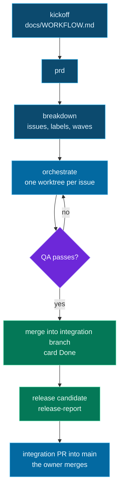

# aiCrew

<p align="center"></p>

<p align="center">
  <a href="LICENSE"></a>
  <a href="https://github.com/goeroeku/aicrew/actions/workflows/tests.yml"></a>
  
  
  
</p>

> [!NOTE]
> **aiCrew** is part of **AICosystem**.

A Claude Code plugin that runs a project workflow from idea to release candidate: **kickoff → PRD → breakdown into issues → parallel execution by roles**
(principal, senior-coder, qa, security, perf, devops, ui-ux), each on a model sized to the weight of the task. Commands, options, keys and labels are English; skills, agents and script messages are still written in Indonesian (English by default is planned, see issue #64). See [`CHANGELOG.md`](CHANGELOG.md) for history.

Principle: **every gate is manual by default (the owner decides)**; each can be switched to automatic in your project's `docs/WORKFLOW.md`.

## 🧭 Flow



Real (trimmed) output from the test project `aicrew-uji`; script output is in Indonesian. Autopilot log for an issue that finished on its own:
```
2026-10-28 11:50:55 putaran 1: 1 issue terbuka (0 needs-principal)
2026-10-28 11:53:22 autopilot: semua issue selesai (putaran 1)
```
Release-candidate report (`release-report.sh`):
```
# Laporan calon rilis: uji-integrasi -> main
**Vonis fakta: SIAP**
## Suite penuh (salinan segar uji-integrasi)
`node --test` -> exit 0: ℹ tests 14 ℹ pass 14 ℹ fail 0
## PR ter-merge ke uji-integrasi
- #17 Tes regresi: pesan kesalahan CLI untuk operasi tak dikenal
- #15 README: bagian Batasan
```

## 📦 Requirements
- Claude Code, `git`, `jq`, and `gh` (logged in; GitHub backend). GitLab (`glab`) is only partly supported.
- Optional: `codex` (the senior-coder writes code through Codex; otherwise Claude subagents are used), the `gh` `project` scope (kanban), `caffeinate` (macOS, keeps the Mac awake during autopilot).

## 🚀 Install and try
No clone or fork needed (Claude Code downloads this repository itself as a marketplace):
```
claude plugin marketplace add goeroeku/aicrew
claude plugin install aicrew@aicrew
```
Inside a Claude Code session the forms are `/plugin marketplace add goeroeku/aicrew` and `/plugin install aicrew@aicrew`. If SSH to GitHub is not set up,
use the full URL: `claude plugin marketplace add https://github.com/goeroeku/aicrew.git`. Installed: 5 skills, 8 agents, 2 hooks.
To try a local copy without installing: `claude --plugin-dir /path/to/aicrew`.

**Download without the marketplace:** every release (tag `vX.Y.Z`) on the Releases page contains `aicrew-X.Y.Z.zip`, `.tar.gz` and `SHA256SUMS`. Verify, then use:
```
shasum -a 256 -c SHA256SUMS
unzip aicrew-X.Y.Z.zip
claude --plugin-dir ./aicrew-X.Y.Z
```

Then, in your project: `/aicrew:kickoff` (writes `docs/WORKFLOW.md`), `/aicrew:prd`, `/aicrew:breakdown`, `/aicrew:orchestrate`.

## ⚙️ Configuration (`docs/WORKFLOW.md`)
`kickoff` writes `docs/WORKFLOW.md` from `templates/WORKFLOW.md`; scripts read it (from the integration branch when one exists, via `scripts/workflow.sh`). Keys and values are English (the Indonesian forms from 1.0 are still accepted as deprecated aliases; see Stability). The most used:

| Key (as written in the file) | Meaning |
|---|---|
| `Integration branch: <name>` | Integration branch where dependent issues pile up instead of `main` |
| `Worktree:` / `Worktree base:` | Who creates worktrees; absolute base path (e.g. Orca workspaces) |
| `Done card: owner \| agent-after-merge` | Who moves a card to Done |
| `Close issues after integration merge: yes \| no` | `board.sh --sync` closes issues proven to be on the integration branch |
| `Clean up after merge: yes \| report \| no` | Cleanup of orchestrator-owned branches and worktrees after a verified merge (default `yes`) |
| `CVE check: no` | Turns the dependency CVE gate off |
| `Private packages: <patterns>` | Packages that are never sent to OSV |
| `Release notes: CHANGELOG.md \| external \| none` | Opt-in release notes built from PR bodies (default `none`) |
| `Integrated label:` and other `Label …:` lines | Rename the default labels (`integrated`, `auto-decision`, `unsplit`, `no-parent`, `awaiting-release`) |
| `Artifact language` | Language of code, comments, commits and labels (default English) |

## 🎛️ Automatic options (all manual by default)
| Gate | Default | Option |
|---|---|---|
| Merge PR into the integration branch | owner | `agent-after-qa` (green suite + QA passes + no `needs-principal`) |
| Card Done on the board | owner | `agent-after-merge` |
| `needs-principal` level 1 (design decision within the PRD) | owner | `principal-auto` (recorded as `auto-decision`) |
| `needs-principal` level 2 (contradicts the PRD, auth/money/personal data, hard to reverse) | owner | no automatic option |
| Merge into `main` | owner | none yet |

## 🤖 Autopilot (days-long, limit-tolerant)
`bash scripts/autopilot.sh [--sleep 1800] [--max-total N]` from the project's repository root: runs `claude -p` with the orchestrate skill repeatedly
(a fresh session each round; state lives on GitHub and in `.aicrew/`), sleeps and retries when a usage limit is hit, and stops when done (exit 0),
after consecutive errors (1), when stuck (2), when only waiting for the owner (3), or at the total limit (4). Log: `.aicrew/autopilot.log`.
`--max-total` counts across runs; `--reset-total` starts from zero.

**Waiting for the owner.** When a round changes nothing and every remaining issue only waits for a human (`needs-principal`, an open PR waiting for merge, or a `## Blocked by` chain ending in one of those),
autopilot stops running `claude` and polls through `gh` every `--wait` seconds (default 600) without spending tokens. As soon as something changes (e.g. you merge a PR),
the next round runs and Resume finishes the rest; you do not need to tell it through chat. The wait limit `--wait-max` (default 7 days) ends with exit 3 and one notification. The last round's fingerprint is kept in `.aicrew/`, so after a laptop restart autopilot waits right away instead of burning a round.

**Idle watchdog.** A `claude -p` round that sits idle (no transcript file changed and no non-helper child process, apart from MCP/LSP helpers) for `--idle-limit` seconds (default 1800; 0 disables; also `AICREW_IDLE_LIMIT`) is ended by `autopilot.sh` with SIGINT; a session that holds on gets SIGTERM after a grace period (never SIGKILL), then the next round starts with a fresh issue list. `--round-timeout` (default 0) adds a wall-clock limit per round, and three idle rounds in a row without change stop through `--stuck` (exit 2). Your own Ctrl-C still stops autopilot. `.aicrew/autopilot.json` holds the phase (`putaran`, `menunggu-owner`, `tidur-limit`, `idle-diinterupsi`, `selesai`), round number and a heartbeat. A wrapper in `AICREW_CLAUDE` must `exec claude ...`.

### Resume after a laptop sleeps or restarts (macOS)
`bash scripts/autostart.sh install <repo> --max-total N` installs a per-project LaunchAgent (at login and every 15 minutes) that runs `autopilot.sh` when it is not already running.
`--max-total` is required (cost cap); the permissions from `scripts/install-permissions.sh` must be installed first. Safeguards: `.aicrew/PAUSE` skips ticks; `.aicrew/halted` (autopilot stopped
with an exit other than 0/3/4) blocks later ticks until `autostart.sh resume <repo>`; a PID lock prevents duplicate autopilots; without `gh`/network the tick is skipped.
The Telegram token is read from `~/.config/aicrew/env` (`export AICREW_TG_TOKEN=... AICREW_TG_CHAT=...`, mode 600), not from the plist. See `autostart.sh status|uninstall <repo>`.

> [!IMPORTANT]
> `-p` sessions cannot ask for approval, so tool permissions must be installed first. Minimal list: `templates/autopilot-permissions.json`;
> install it into the project's `.claude/settings.local.json` with `bash scripts/install-permissions.sh` (merges, never overwrites; fills in your paths).
> Do not use `--dangerously-skip-permissions`. Extra arguments go through `AICREW_CLAUDE_ARGS` (e.g. `--max-budget-usd 3`).
>
> **Limit detection.** A limit is recognized when its text is in the last 20 lines **and** (the `claude -p` exit code is not 0, or the output is short, at most 3 lines). A normal, long orchestrator report may contain a sentence such as "No agent hit a usage limit" without triggering a 30-minute sleep. Each round's exit code is logged in `.aicrew/autopilot.log` (`putaran N: rc=...`), and output that mentions a limit or has a non-zero exit code is archived in `.aicrew/archive/round-<run>-<round>-rc<code>.log` (the last 20), so the next real limit is captured in full. The limit message pattern is a guess not yet proven with a real limit: whether the exit code is non-zero is unverified (an API error has been reported to end with code 0), so short output is still treated as a limit; if the pattern misses, the round counts as an error and autopilot stops safely after 3.

## 📋 Release candidate and release notes
`bash scripts/release-report.sh --test-cmd "<full test command>" --dry-run` writes `.aicrew/release-report.md`: a factual verdict READY/NOT READY
(suite in a fresh copy, PRs without evidence, issues not yet integrated, `needs-principal`). `--open-pr` (without `--dry-run`) opens the integration PR into main when READY. It never merges.

**Release notes (opt-in).** With `Release notes: CHANGELOG.md` in `docs/WORKFLOW.md`, PR authors put one line per entry in the PR body (`Release note: Fixed - …`, `Behavior change: …`, or `Release note: -` for an internal PR; example in `templates/pull_request_template.md`). `scripts/release-notes.sh --version X.Y.Z [--write]` builds the `CHANGELOG.md` section (Keep a Changelog) from those lines of the PRs merged since the previous tag, deterministically (no model). `release.yml` uses that section as the release description; the PR gate and `check-version.sh` only warn when a line or section is missing. Only marked lines are used, so a public release never leaks the rest of a PR body.

## 🧭 Journeys and epics (for the lead)
A lead usually asks per journey ("when can users sign in with SSO?"), not per task. The hierarchy:
```
Journey / epic   J1: users can sign in with SSO            <- read by the lead (issue labeled epic, "4/7 done")
  └ FR / NFR     R3, R4, N1 (Requirements section of PRD)  <- verifiable criteria
       └ Issue   #12, #13, #14                             <- small tasks done by agents
```
The PRD has *Journeys* and *Non-functional requirements* sections; breakdown creates one epic per journey (`templates/EPIC.md`) with a checklist of child issues.
In a running project, creating epics does not edit old issues (they are only referenced); anything that does not fit goes into the epic `[J0] Unassigned`.
Journey = epic = parent; work issues are native sub-issues of the epic (`scripts/epic-link.sh <epic> <children...>` links them through the checklist and native sub-issues, idempotently; `--inherit <source> <child>` makes a follow-up issue inherit its source epic; `--check` lists open non-epic issues without a parent, exit 3 if any).
**On the kanban:** epics sit on the board with a status computed from their children by `board.sh <owner> <number> --sync`: Backlog (no child running), In progress (a child running or some children Done), In review (all children done, at least one non-discovery child, epic not labeled `unsplit`; ready for the owner to close), Done (closed by the owner). Progress ("6/9 Done, 1 In progress") is written to a single marked epic comment. Epics are not work: agents and scripts skip them.
With `Close issues after integration merge: yes`, an issue counts as *on the integration branch, not yet released*; the release marker is the integration PR into `main` and the `integrated` label, not the closed state. **Integration is verified:** the label, closing and card Done are only given when `scripts/integrated.sh <pr>` proves the PR reached the integration branch (a stacked PR merged into a parent branch does not qualify).
**One-time manual UI steps** (no API for project views): on the kanban view, add the *Parent issue* column and set *Group by → Parent issue*; create a saved view "Journeys" with the filter `label:epic`.

**Scheduled workflows and Dependabot.** GitHub only runs `schedule`, `workflow_dispatch` and `dependabot.yml` from the default branch. `pr-merge-check.sh` warns (never blocks) when a PR adds such files to a non-default branch; the issue gets the `awaiting-release` label (`scripts/awaiting-release.sh`) and is closed only once the files exist on the default branch. `cve-audit.sh` reports scheduled workflows that exist only on the integration branch; the `cve-audit` skill documents a bridge pattern for repositories released from a non-default branch, and `templates/dependabot.yml` groups action updates.

## 🛡️ Dependency CVE check
`scripts/cve-check.sh <lockfile> [--base <base>]` checks `package-lock.json` (npm), `go.mod` (Go) and `requirements*.txt` (PyPI, `name==version` only) against OSV: package, version, ID, CVE, severity, scope (`prod|dev`), target, advice (`patch|minor|major|tanpa-perbaikan`) and exposure (`baru|lama`). The target is the lowest version that closes every vulnerability of that package; an empty severity on Go/PyPI records is borrowed from the GHSA twin, and anything still unranked (`UNKNOWN`) is treated like HIGH.
**PR gate:** when the diff touches a manifest or lockfile, `pr-merge-check.sh` checks only packages that are new or changed compared with the merge-base, and blocks new HIGH/CRITICAL/UNKNOWN exposure on `prod` dependencies unless there is an owner waiver `(cve)` (`Pengecualian disetujui owner (cve): <reason> (Commit: <sha>)`); old vulnerabilities, `dev`, MODERATE and LOW only warn. OSV unreachable means reject (fail-closed), which a `(cve)` waiver also closes. An incomplete lockfile only warns (the gate does not reject because of it). The opt-out `CVE check: no` is read from the target branch, not from the PR.
**Repository audit:** the `cve-audit` skill (`scripts/cve-audit.sh [--dry-run]`) creates one issue per vulnerable package over REST (`needs-security`; `major` or no-fix advice also `needs-principal`), without duplicates; schedule it with `/schedule`. There are no automatic updates, and the report never says "CVE-free": only "no known vulnerabilities in OSV as of `<date>`".
**Private packages:** list them in `WORKFLOW.md` with `Private packages: @company/*, git.company.com/team` (other sources: `GOPRIVATE`, project `.npmrc` scopes mapped to non-public registries). They are never sent to OSV and are reported as "not checked", by count and never by name. Patterns are read from the target branch and the gate fails closed when they cannot be read.
Only the ecosystem, package name and version go to OSV (see [`PRIVACY.md`](PRIVACY.md)). Not covered yet: Docker/OS base images, transitive dependencies without a lockfile, `yarn.lock`, `pnpm-lock.yaml`, `Cargo.lock`, `Pipfile.lock`, `poetry.lock`, and `package.json` without a lockfile; npm lockfile v1 and requirements lines using `>=` or `-r` are skipped and reported as `PERINGATAN: cve (<file>) tidak lengkap`.

## 🧹 Branch and worktree cleanup
`scripts/cleanup.sh` reports local and `origin` branches and worktrees that are **proven** merged: the tip is an ancestor of the default or integration branch, or a merged PR has the same `head.sha` (detects squash/rebase merges). By default it only reports (TSV: kind, name, SHA, evidence, action); `--apply` removes in order: worktree (never `--force`), local branch, then remote with `--force-with-lease`, and prints the tip SHA so everything can be restored (`git branch <name> <sha>`). It never touches the default or integration branch, branches that are the `head` or `base` of an open PR, branches still checked out, dirty/locked/detached worktrees, or `~/orca/workspaces/`. Evidence from a merged PR only counts when its base is the default or integration branch. A new branch with no commits (tip equal to its base) is never deleted, and an unreadable `WORKFLOW.md` or option means report-only.
**Automatic for orchestrator-owned artifacts:** after a verified merge, `orchestrate` calls `cleanup.sh --after-merge --issue <n>`, which removes the worktree `<repo>-wt-<n>` and branch `issue-<n>` according to `Clean up after merge: yes|report|no` (a missing line means `ya`). Branches with other names are never removed automatically. `preflight.sh` warns when the GitHub setting `delete_branch_on_merge` is false (fix: `gh api -X PATCH repos/<r> -F delete_branch_on_merge=true`; the plugin never changes that setting itself) and shows the number of merged branches from offline evidence.
**Note:** `git worktree remove` (without `--force`) refuses worktrees with uncommitted changes, but still removes git-ignored files inside the worktree (e.g. `.env.local`, a local database); save them first if needed. GitHub only (other backends exit 0 with a message); no `git gc`.

## 🔁 REST fallback
GitHub's GraphQL limit (5,000 points/hour) is shared by every tool on one account. When `board.sh` or `epic-link.sh` hits it (`scripts/ghx.sh` detects it), they retry once through REST (issues, sub-issues, comments and Project v2 cards) and announce `mode cadangan REST` on stderr, with no retry loop; the reset time is read from the GraphQL response headers, not from `gh api rate_limit`, which can mislead. `board.sh --sync` reads children from native sub-issues (fallback: the checklist). Steps that need GraphQL-only data are skipped, not guessed: `board.sh --sync` still exits 0 and prints `PERINGATAN: N langkah dilewati (batas GraphQL), jalankan --sync lagi setelah reset`. Cards need the `project` scope; on REST 403/404 the card operations are skipped with the same warning. `pr-merge-check.sh` deliberately keeps refusing when it cannot read a PR (an issue closed through the sidebar only exists in GraphQL); the refusal now names the GraphQL limit and the reset time (UTC). `scripts/lock.sh <name> [--wait seconds] -- command...` runs a command under a named lock (atomic `mkdir`, a dead holder is taken over, timeout = exit 75) for tests that share a Docker/Keycloak stack. Issues that intentionally have no parent get the label `no-parent` and are skipped by `epic-link.sh --check`.

## 🗂️ Kanban (optional)
`scripts/board-init.sh` creates a GitHub Project, links it to the repository, normalizes the statuses and creates a board view (`createProjectV2View` with `BOARD_LAYOUT`; a new project only has a table view). `scripts/board.sh` moves cards; `board.sh <owner> <number> --sync` moves issues closed without a PR to Done when `Done card: agent-after-merge`. Needs the `gh` `project` scope.
> [!NOTE]
> The built-in "Item closed" workflow (card moves to Done automatically when an issue closes) **cannot be enabled through the API**: GraphQL only has `deleteProjectV2Workflow`. Enable it once in the UI: Project → Workflows → Item closed → Enable. Without it, use `--sync`.

## 🧩 Orca and labels
- **Orca**: `AICREW_NOTIFY=orca` (or `both`, or the plugin option `notify`) marks the workspace unread through `orca worktree set --worktree path:<dir> --unread --comment ...`. Orca launches agents with `--dangerously-skip-permissions` by default (deny rules are not enforced); `preflight.sh` warns about it. Set `Worktree base:` (an absolute path) in `docs/WORKFLOW.md` so `install-permissions.sh` grants the right read permissions.
- **Risk**: breakdown labels `risk:L0|L1|L2`; auto-merge (`pr-merge-check.sh --auto`) refuses L2.
- **Permissions**: `gh pr merge` is only installed for the `agent-after-qa` mode; `gh repo delete`, `gh ssh-key`, `gh gist` and `gh auth` (except `status`) are denied.
- **Label names**: `integrated` and `auto-decision` can be renamed through `Integrated label:` / `Auto-decision label:` in `WORKFLOW.md` or `AICREW_LABEL_INTEGRATED` / `AICREW_LABEL_AUTO` (see `scripts/label.sh`).
- `kickoff` adds `.aicrew/` and `.claude/settings.local.json` to `.gitignore` (`scripts/ensure-gitignore.sh`).

## 🔔 Notifications and data sent (optional)
By default this plugin **sends nothing off your machine**. The only outbound network is the `Notification` hook (`scripts/notify.sh`) and the CVE check (`api.osv.dev`, ecosystem, package name and version only).
Telegram is only active when **you** fill in your own bot token and chat ID: through the plugin settings (`tg_token`, `tg_chat`; the token is kept in Claude Code's secure storage) or the environment variables `AICREW_TG_TOKEN` and `AICREW_TG_CHAT`. Do not keep the token in repository files.
When active it sends one message to `api.telegram.org` containing the notification text (e.g. "issue #N needs a decision") and the project folder name. No code, issue or conversation content.
Otherwise, scripts call `gh` and `git` on your behalf against your own project repository. Details: [`PRIVACY.md`](PRIVACY.md).

## 🧱 Stability
From 1.0 aiCrew follows [Semantic Versioning](https://semver.org/). The public interface is: the flags and exit codes of `scripts/*.sh` documented in this README, the keys and values of `docs/WORKFLOW.md`, the default label names, and the `.aicrew/autopilot.json` format. Skill and agent wording, log lines and messages are not part of that interface and may change in any minor release. Behavior changes to defaults are listed under *Behavior changes* in [`CHANGELOG.md`](CHANGELOG.md).

**Deprecated aliases (accepted through 1.x, removal only in a major release).** Scripts: `alur-terjadwal.sh`, `menunggu-rilis.sh`, `terintegrasi.sh` (now `scheduled-workflow.sh`, `awaiting-release.sh`, `integrated.sh`). Options: `--versi`, `--sejak`, `--tanggal`, `--tulis`, `--ekstrak`, `--buka-pr`, `--cek`, `--hitung`, `--parse-badan`, `--setelah-merge`, `--tandai` (now `--version`, `--since`, `--date`, `--write`, `--extract`, `--open-pr`, `--check`, `--count`, `--parse-body`, `--after-merge`, `--mark`). `WORKFLOW.md` keys such as `Cabang integrasi`, `Bersihkan setelah merge`, `Pemeriksaan CVE`, `Paket privat`, `Kartu Done`, `Profil` and values such as `ya`, `tidak`, `laporkan`, `agen-setelah-QA`, `agen-setelah-merge` are rewritten to the English forms by `scripts/lib/wf-normalize.sh`. Labels `di-integrasi`, `keputusan-otomatis`, `belum-dipecah`, `tanpa-induk`, `menunggu-rilis` remain recognized on existing issues.

## ⚠️ Warning

> [!WARNING]
> This plugin runs code, creates worktrees, runs `git push`, opens and (if you allow it) merges PRs on your behalf, and can run unattended.
> Review the permission list before installing, start with a small project, and set a cost cap. Provided as is, without warranty (see `LICENSE`).

## 🧪 Tests
`bash tests/run.sh` (offline; needs bash and jq). Also run on GitHub Actions.

## 📄 License and credits
Licensed under **MIT**: free to use, modify and share. Copyright (c) 2026 goeroeku. aiCrew is part of AICosystem. Copies or derivatives must keep the copyright notice and license text ([`LICENSE`](LICENSE)).
